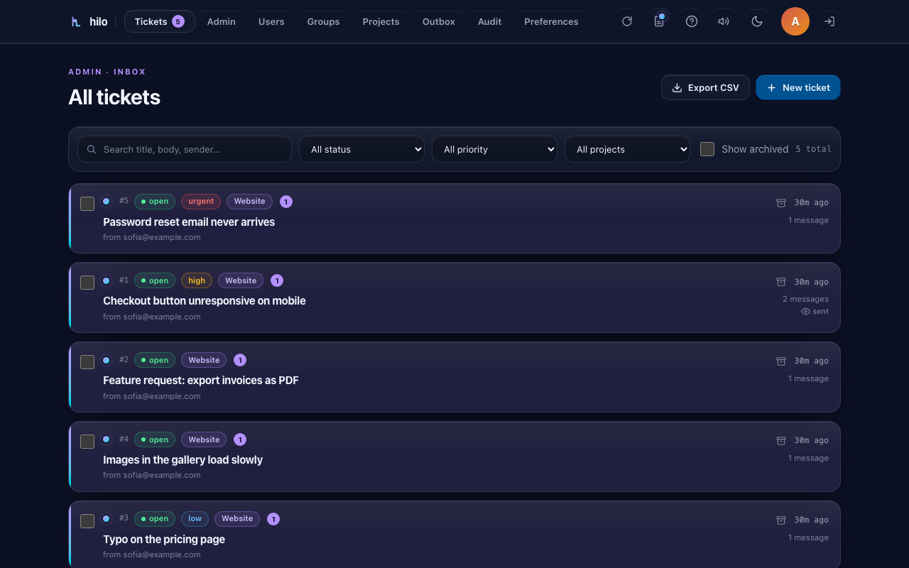
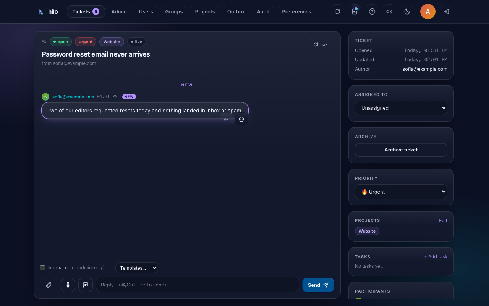

# Hilo

> **Feedback & support, simply.**
> Self-hosted ticket + chat platform with magic-link emails, voice notes and
> on-device transcription. One Node process, one SQLite file, three npm
> dependencies, MIT licensed.

[](https://github.com/Ingenarte/hilo-community/actions/workflows/ci.yml)
[](LICENSE)

<p align="center">
  
</p>

Hilo gives you a URL where invited users can sign in, open tickets, and have
a threaded chat with you. Every reply can send a rich, themed email with a
tokenised link — one click and the recipient is signed in, looking at the
conversation.

It's a **no-frills alternative to Chatwoot or Freescout** for the
"support inbox for invited users" use case (think
`support.yourdomain.com`).

---

## Why Hilo

| | Chatwoot / Freescout | Hilo |
|---|---|---|
| Setup time | 30 min – several hours | ~3 minutes |
| Runtime services | DB + Redis + Sidekiq + browser bundler | Node + SQLite (+ optional Whisper sidecar) |
| Container image | hundreds of MB | ~80 MB |
| Default storage | Postgres + S3 | one SQLite file + ./uploads |
| Voice + transcription | external / paid | built-in, self-hosted Whisper |
| Realtime | ActionCable / sockets | Server-Sent Events |
| Theming | light/dark | per-user light/dark + 4 accents |
| Webhooks | Slack/Discord/custom | Slack/Discord/custom |
| FTS search | yes | yes (SQLite FTS5) |

Pick Hilo when you want something **small, boring, restartable — fits in one
`git clone`** and runs on the cheapest VPS you can find.

---

## Quick start

```bash
git clone https://github.com/Ingenarte/hilo-community hilo
cd hilo
cp .env.example .env             # set ADMIN_EMAIL, AUTH_FIXED_PASSWORD, SMTP_*
pnpm install
pnpm dev                         # http://localhost:5180
```

The first request creates the SQLite file, seeds the default project, and
provisions the admin user from `ADMIN_EMAIL`.

For production the Docker stack is the recommended path — it includes the
transcription sidecar:

```bash
docker compose up -d             # app on :3000, whisper sidecar internal
```

Or bare-metal: `pnpm build && NODE_ENV=production pnpm start`, dropped
behind Caddy / nginx (templates in [`deploy/`](deploy/)).

---

## What's inside

- **Tickets + realtime chat.** One thread per topic, live over Server-Sent
  Events, with typing indicators, reactions and message editing.
- **Voice messages + self-hosted transcription.** Record up to 2 minutes,
  transcribe with one tap on a local faster-whisper sidecar — audio never
  leaves your server. Dictation mode streams speech into the composer.
- **Resumable uploads up to 500 MB.** Chunked (tus-style), survives page
  reloads and flaky connections. Inline image previews, seekable in-browser
  video playback.
- **Read receipts & presence.** Grey check = sent, double check = read (with
  reader name and time). Unread stripes, navbar badge, inbox "seen" eye.
- **Tasks inside tickets.** Create, assign to any participant, tick done;
  pending-task chips surface in the inbox.
- **Magic-link email notifications.** Every reply emails a tokenised URL that
  signs the recipient in and lands on the conversation. Emails are themed
  (dark/light), embed images inline and show file chips.
- **Inbound email → ticket** (IMAP polling).
- **Web Push notifications** (VAPID) with per-user quiet hours and daily
  digest throttling.
- **Projects & groups.** Organize tickets per project, group users, CSV
  import, merge, per-user project assignment.
- **Ticket lifecycle**: status, priority (low → urgent), assignment, internal
  notes, followers/CC, archive/restore, bulk admin actions, canned response
  templates.
- **Admin console**: multi-admin, user management with device-class insights,
  audit log viewer, email outbox with retries, workspace CSV export.
- **Outbound webhooks** (Slack, Discord, generic JSON) on
  `ticket.new`, `ticket.reply`, `ticket.urgent`, `ticket.closed`, `ticket.assigned`.
- **Full-text search** (SQLite FTS5) over titles + message bodies, plus
  status / priority / project / archive filters and pagination.
- **PWA-installable** on iOS / Android / Windows / macOS with built-in guided
  install videos, plus optional start-at-login helper scripts.
- **Public landing page** at `/` for anonymous visitors (promo video +
  feature overview), configurable via `PUBLIC_*` env vars.
- **Production posture**: `/api/health`, `/api/metrics` (Prometheus),
  structured JSON access logs, rate limits, honeypot login field, CSP + HSTS
  + frame-deny headers, retried SMTP sends, upload retention cleanup.
- **Backup** in one bash command, **cleanup** in one node script.

---

## Screenshots

| Inbox | Ticket |
|---|---|
|  |  |

---

## Stack

| Layer | Choice | Why |
|------|--------|-----|
| Web framework | SvelteKit 2 + Svelte 5 | Tiny output, SSR + endpoints in one repo |
| DB | better-sqlite3 | Synchronous, embedded, plenty for small teams |
| Email | Nodemailer | Gmail App Password works on day one |
| Uploads | tus-js-client | Resumable chunked transfers |
| Transcription | faster-whisper (Docker sidecar) | Self-hosted, CPU-only, MIT |
| Realtime | Server-Sent Events | One TCP connection, no extra deps |
| Styles | Tailwind v4 | OKLCH palette, glassmorphism utilities |
| Search | SQLite FTS5 | No external service |
| Runtime | Node ≥ 20 | Native `fetch`, `crypto`, no transpile |

**Three runtime dependencies.** Everything else is dev/build tooling.

---

## Configuration

All variables live in `.env` (copy `.env.example` and edit). The
highlights — see the example file for the full annotated set.

| Variable | Required | Default | Meaning |
|---|:---:|---|---|
| `PUBLIC_BASE_URL` | yes | `http://localhost:5180` | Magic links, CSRF origin, install-guide copy. |
| `PUBLIC_BRAND` | no | `Hilo` | Short label across UI/email. |
| `PUBLIC_SUPPORT_EMAIL` | no | — | Invite contact shown on the login page. |
| `PUBLIC_INSTANCE_OWNER` | no | — | Organization name shown on the landing page. |
| `ADMIN_EMAIL` | yes | — | The first admin user (auto-created). |
| `AUTH_FIXED_PASSWORD` | yes | — | Bootstrap password; users get individual passwords. |
| `AUTH_DYNAMIC_FORMAT` | no | `ddmmyy` | Optional date-derived second factor (`none` to disable). |
| `SESSION_SECRET` | yes | — | 48+ random bytes. |
| `SMTP_*` | yes | — | Gmail App Password is the easy path. |
| `VAPID_*` | no | — | Web Push keys (`npx web-push generate-vapid-keys`). |
| `MAX_UPLOAD_MB` | no | `500` | Per-attachment total cap (chunked). |
| `UPLOAD_RETAIN_DAYS` | no | `180` | Attachment retention; 0 = keep forever. |
| `WHISPER_URL` | no | sidecar | Transcription service endpoint. |

---

## Deploy

- **Docker** (recommended): `docker compose up -d`. Volume at `/data`
  persists DB + uploads; the faster-whisper sidecar is included.
  A production overlay with a Cloudflare Tunnel sidecar is provided in
  [`docker-compose.production.yml`](docker-compose.production.yml).
- **systemd + Caddy**: copy [`deploy/Caddyfile.example`](deploy/Caddyfile.example) and [`deploy/hilo.service.example`](deploy/hilo.service.example).
- **nginx**: [`deploy/nginx.conf.example`](deploy/nginx.conf.example) (SSE-safe).

Backup with [`scripts/backup.sh`](scripts/backup.sh) (daily cron).
Cleanup with [`scripts/cleanup.js`](scripts/cleanup.js) (weekly cron).

---

## Promo & install videos

[`video-remotion/`](video-remotion/) is a standalone Remotion project that
renders the landing-page promo (`Promo`) and the four PWA install explainer
videos into `static/`. See [`video-remotion/NARRATION.md`](video-remotion/NARRATION.md)
for the narration script and HeyGen avatar slots.

---

## Health & observability

- `GET /api/health` — JSON liveness probe (status, uptime, pid).
- `GET /api/metrics` — Prometheus exposition (ticket counts, message
  counts, attachment bytes, sessions, pending magic links, uptime).
- Structured JSON access log to stdout, one line per request.
- `X-Request-Id` header on every response.

---

## Security posture

Hilo targets the "invited guests on a private URL" regime — it is not the
front gate of anything sensitive. What it does protect:

- Per-user scrypt password hashes; brute-force limits on `/login` and `/m/<token>`
- Honeypot field traps the cheapest bots
- Single-use magic-link tokens, 30-day TTL
- XSS-safe message rendering (escape-then-linkify)
- Authorised attachment fetch (per-request DB join)
- Upload MIME allow-list + size caps
- CSP, HSTS (prod), nosniff, frame-deny, referrer-policy
- `Secure` session cookie in production

See [`SECURITY.md`](SECURITY.md) for reporting vulnerabilities.

---

## Keyboard shortcuts

| Key | Action |
|---|---|
| `/` | Focus search |
| `n` | New ticket |
| `g i` | Go to inbox |
| `g s` | Go to settings (admin) |
| `Ctrl/⌘+↩` | Send message |
| `?` | Show cheat-sheet |

---

## Local staging & tests

E2e tests run against a local Docker stack so they never touch real data.

```bash
pnpm stage:up        # build + start at http://localhost:3001
pnpm stage:seed      # admin@local.test / admin-local-pw, user@local.test / user-local-pw
pnpm test:e2e        # core-flow tests against localhost:3001
pnpm stage:down      # stop
```

---

## Contributing

PRs are welcome. Please read [`CONTRIBUTING.md`](CONTRIBUTING.md) first.
The charter is **small, self-hosted, SQLite-only, one binary**. Changes
that pull in Redis / Postgres / Kafka / external queues are usually
declined.

Run `pnpm check` (must report 0 / 0) and `pnpm test` before opening a PR.

---

## License

MIT © Hilo contributors. See [`LICENSE`](LICENSE).
